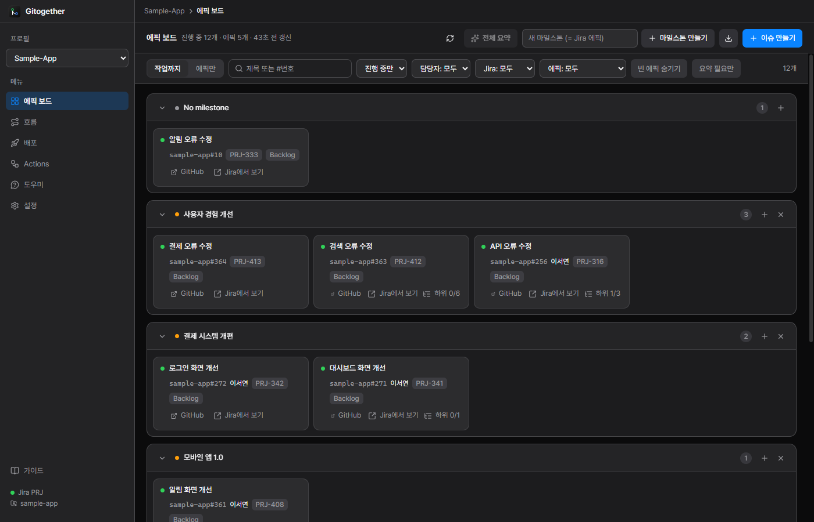
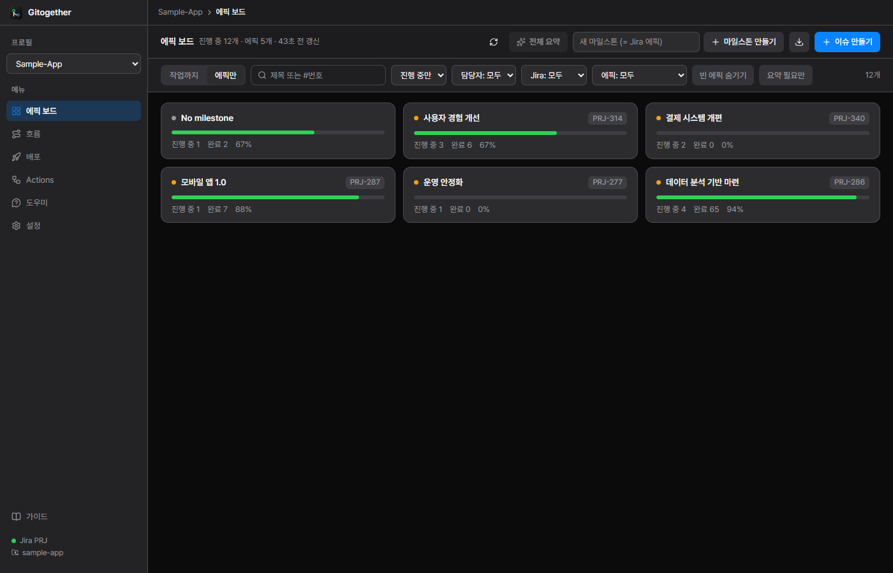
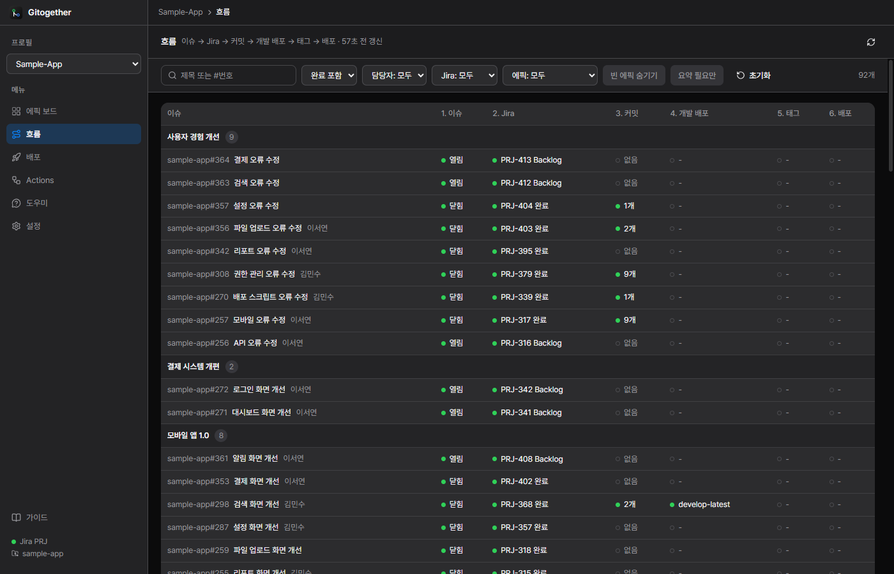
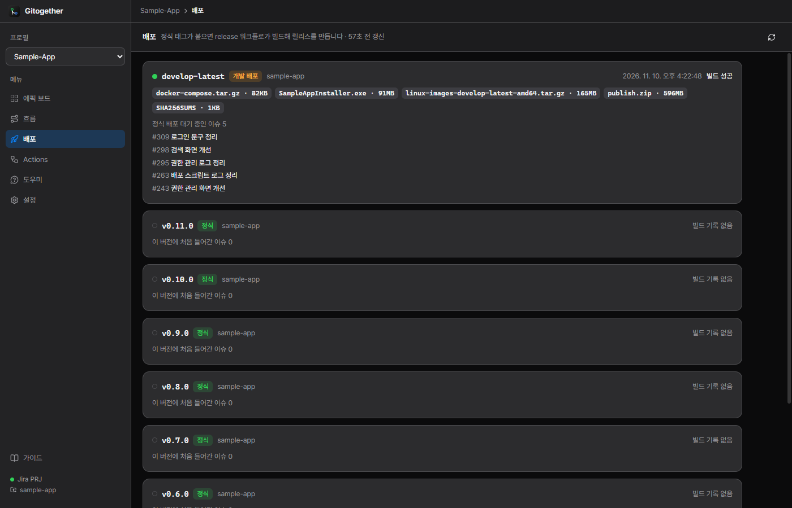
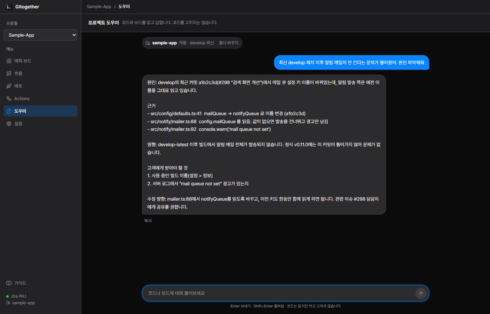
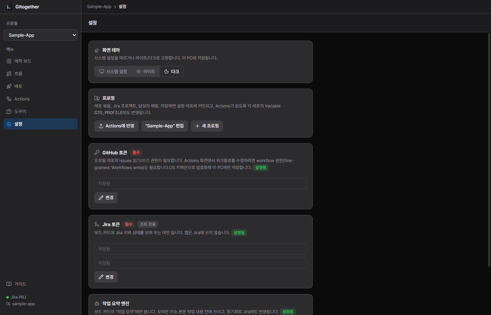

# Gitogether

**GitHub 이슈 하나로 Jira, 커밋, 배포, 유지보수까지 한 화면에서 이어 보는 팀 작업 보드**

개발자는 GitHub에서 이슈를 만들고 커밋만 합니다. Jira 이슈 생성, 에픽 연결, 작업 기록, 작업 요약은 Gitogether가 대신 합니다.
PM과 팀장은 같은 화면에서 "이 이슈가 지금 어디까지 왔는지(Jira → 커밋 → 개발 배포 → 정식 배포)"를 바로 봅니다.

- 데스크톱 앱(Electron, Windows)과 웹 버전(사내 서버 한 대) 두 가지로 씁니다.
- 앱은 **GitHub에만 씁니다.** Jira는 읽기만 하고, Jira 쪽 생성·갱신은 대상 레포의 GitHub Actions가 합니다.
- 작업 요약과 프로젝트 도우미는 Claude·Codex·Antigravity CLI(각자 구독) 또는 Claude API 키로 동작합니다.

> 스크린샷의 레포, 이슈 제목, 담당자 이름은 모두 예시 값입니다.

---

## 화면

### 에픽 보드



- 구역 하나가 **마일스톤(= Jira 에픽)** 하나, 카드 하나가 **GitHub 이슈** 하나입니다.
- 에픽은 위아래로 쌓이고 카드는 구역 안에서 바둑판처럼 채워져서 가로 스크롤 없이 아래로만 내려 봅니다. 구역 머리의 ▸로 접고 펼치며, 접은 상태는 기억됩니다.
- 카드를 다른 구역으로 끌어 놓으면 에픽이 바뀝니다. Ctrl·Shift로 여러 장을 고르면 아래 막대에서 한 번에 에픽 이동·닫기를 합니다.
- 카드에는 레포#번호, 담당자, Jira 키와 Jira 상태, 하위 작업 진행(하위 0/2), 요약 상태가 붙습니다.
- 우클릭 메뉴: GitHub·Jira 열기, 하위 작업 보기/만들기, 에픽 이동, 닫기·다시 열기, 링크 복사, 커밋용 번호 복사(`#357`).
- 필터: 검색(제목 또는 #번호), 진행 중/완료, 담당자, Jira 상태, 에픽, 빈 에픽 숨기기, 요약 필요만.
- 오른쪽 위에서 이슈 만들기, 마일스톤 만들기, Jira에 이미 있는 에픽 가져오기, 전체 요약을 합니다.

### 에픽만 보기



에픽별 진행 중·완료 개수와 진행률만 모아 봅니다. 주간 회의에서 전체 상황을 훑을 때 씁니다.

### 흐름: 이슈가 어디까지 왔는지



이슈마다 **이슈 → Jira → 커밋 → 개발 배포 → 태그 → 배포** 6단계를 한 줄로 보여 줍니다.

- 개발 배포·태그 단계는 "이슈의 마지막 커밋이 그 빌드에 들어갔는가"로 판단합니다.
- 행을 누르면 오른쪽 패널에 단계별 링크와 기록된 커밋이 나옵니다.
- 고객 문의에 "그 수정 언제 나가요?"를 바로 답할 수 있습니다.

### 배포



레포별 개발 배포(`develop-latest`)와 정식 태그를 최신순으로 봅니다.

- 빌드 상태(누르면 Actions 실행으로 이동), 받을 파일과 크기.
- **이 버전에 처음 들어간 이슈**, 개발 배포라면 **정식 배포를 기다리는 이슈**를 보여 줍니다. 릴리스 노트를 따로 쓰지 않아도 됩니다.

### 프로젝트 도우미



유지보수 질문을 하면 **develop 최신 코드, 최근 커밋, 보드 정보**를 읽고 `파일:줄` 근거로 답합니다. 코드는 고치지 않습니다(읽기 전용 도구만 줍니다).

- 질문할 때마다 앱(또는 웹 서버)이 가진 로컬 저장소를 develop 최신으로 맞춘 뒤 읽습니다. 매번 clone하지 않습니다.
- 데스크톱은 직접 받아 둔 폴더를 지정할 수도 있습니다.
- 예시 질문: "최신 develop 패치 이후 특정 문제가 발생했어. 원인 파악해줘", "#243은 어디까지 배포됐어?"
- 답이 오는 동안 경과 시간 표시, 중지, 다시 시도, 답 복사를 지원합니다.

### 설정



- **프로필**: 어떤 레포들과 어떤 Jira 프로젝트를 묶을지, 담당자 이름 ↔ Jira 계정 연결. 저장하면 설정 레포에 커밋되고, 각 레포의 Actions Variable `GTO_PROFILE`에도 반영됩니다.
- **GitHub 토큰**(필수), **Jira 토큰**(조회 전용), **작업 요약 엔진**.
- 저장된 토큰은 잠겨 있어서 "변경"을 눌러야 바뀝니다.
- 화면 테마: 시스템 설정 / 라이트 / 다크.

### 그 밖의 화면

- **Actions**: 대상 레포의 워크플로 실행 목록, 로그, 재실행, Secrets 등록.
- **가이드**: 설정부터 도우미까지 9단계 사용법. 실제 앱 화면 캡처 위에 번호를 찍어 설명합니다. 캡처는 `app/scripts/guide-shots.mjs`로 실행 중인 앱에서 찍습니다(이 공개 레포에는 캡처가 들어 있지 않습니다).

---

## 동작 방식

```
 개발자                       GitHub (대상 레포)                         Jira
 ──────                       ──────────────────                         ────
 이슈 만들기 ───────────────▶  issues 이벤트 ─▶ gto.yml: sync ─────────▶  이슈 생성, 에픽 연결
 마일스톤 만들기 ───────────▶  milestone 이벤트 ─▶ sync ────────────────▶  에픽 생성·이름 변경
 git commit "… #357" ───────▶  push 이벤트 ─▶ gto.yml: worklog
                                  └─ 이슈 본문 "작업 내용"에 커밋 기록 ──▶  Jira 설명에 동기화

 Gitogether 앱/웹 ◀───────────  이슈·마일스톤·커밋·릴리스 읽기
                  ◀──────────────────────────────────────────────────────  Jira 키·상태 읽기 (읽기 전용)
   └─ 작업 요약(엔진) ───────▶  이슈 본문 "작업 요약" 갱신 ─▶ sync ─────▶  Jira 설명에 반영
```

- **sync** (`sync.mjs`): 이슈·마일스톤 이벤트를 Jira 이슈·에픽으로 만들고 갱신합니다. GitHub 하위 이슈는 Jira 하위 작업이 됩니다. Issue Form의 담당자는 프로필의 계정 연결로 Jira 담당자가 됩니다.
- **worklog** (`worklog.mjs`): push된 커밋 중 메시지에 `#번호`가 있는 것을 이슈별로 모아 이슈 본문의 작업 내용 칸에 덧붙입니다. 모든 브랜치가 대상입니다.
- **작업 요약**: 쌓인 커밋 기록을 요약 엔진이 정리해 이슈 본문과 Jira에 남깁니다. 요약은 앱에서만 하고, GitHub Actions 안에서는 LLM을 부르지 않습니다. 코드 diff는 설정에서 켠 경우에만 요약 엔진으로 보냅니다.

### 요약·도우미 엔진

| 엔진 | 설명 |
| --- | --- |
| Claude CLI | 이 PC(웹은 서버 PC)에 로그인된 `claude`. 각자 구독 요금제로 실행. 읽기 도구(Read, Grep, Glob)만 허용 |
| Codex CLI | `codex`, `--sandbox read-only` |
| Antigravity CLI | `agy --mode plan` |
| Claude API 키 | `claude-opus-5-5` + 읽기 전용 도구(list_files, grep, read_file, git_log, git_show) |

---

## 시작하기

### 1. 대상 레포에 동기화 Actions 넣기

1. 이 레포의 `lib.mjs`, `sync.mjs`, `worklog.mjs`를 대상 레포의 `.github/gto/` 아래에 복사합니다(의존성 없음).
2. `caller/gto.yml`을 대상 레포의 `.github/workflows/gto.yml`로 복사합니다.
3. 대상 레포 Secrets에 `JIRA_EMAIL`, `JIRA_API_TOKEN`을 넣습니다.
4. 프로필은 레포 Variable `GTO_PROFILE`(JSON)로 넣거나 `.github/gto/profiles/*.json`으로 둡니다. 형식은 [`profiles/example.json`](profiles/example.json)을 보세요. 앱의 설정 화면에서 "Actions에 반영"을 누르면 Variable이 자동으로 들어갑니다.

### 2. 앱 실행

```bash
cd app
npm install
npm run dev        # 개발 실행
npm run dist       # Windows 설치 파일(dist/Gitogether-Setup-*.exe)과 포터블 exe
```

앱은 프로필을 설정 레포(`app/src/renderer/src/github.ts`의 `CONFIG_REPO`)의 `profiles/` 폴더에서 읽고 씁니다. 자기 팀의 비공개 레포로 바꿔서 쓰세요.

처음 켜면 설정 탭에서 GitHub 토큰(이슈 읽기·쓰기, 워크플로를 고치려면 workflow 권한), Jira 토큰, 요약 엔진을 넣습니다.
토큰은 OS 키체인으로 암호화해 그 PC에만 저장합니다.

### 3. 웹 버전 (선택)

팀원이 설치 없이 브라우저로 쓰게 하려면 서버 한 대에서 실행합니다.

```bash
cd app
npm install
GTO_PASSWORD=비밀번호 npm run web     # http://서버:8080
```

| 환경 변수 | 설명 |
| --- | --- |
| `GTO_PORT` | 포트 (기본 8080) |
| `GTO_PASSWORD` | 접속 비밀번호. 한 번 넣으면 쿠키로 기억. **비우면 접속한 누구나 저장된 토큰 권한으로 GitHub에 씁니다** |
| `GTO_DATA` | 토큰·설정·도우미용 저장소를 둘 폴더 (기본 `app/data`) |
| `GTO_CERT`, `GTO_KEY` | 지정하면 HTTPS로 실행 |

웹에서는 토큰을 서버에 저장하고 브라우저로 내보내지 않습니다. GitHub 호출도 서버가 토큰을 붙여 중계합니다.
작업 요약 엔진은 서버 PC에 로그인된 CLI를 씁니다.

---

## 레포 구성

```
lib.mjs, sync.mjs, worklog.mjs   대상 레포 .github/gto/ 에 복사해 쓰는 Actions 스크립트
caller/gto.yml                   대상 레포 워크플로
profiles/example.json            프로필 예시
app/                             데스크톱 앱(Electron + React + Vite)과 웹 서버(server.mjs)
  codebase.mjs                   요약·도우미 엔진, 도우미용 로컬 저장소 동기화 (데스크톱·웹 공용)
  scripts/guide-shots.mjs        가이드 화면 캡처
docs/screenshots/                README 스크린샷 (예시 데이터)
```

## 테스트

```bash
npm test                                         # Actions 스크립트 (루트)
cd app && node --test src/renderer/src/github.test.ts
cd app && npm run typecheck
```
